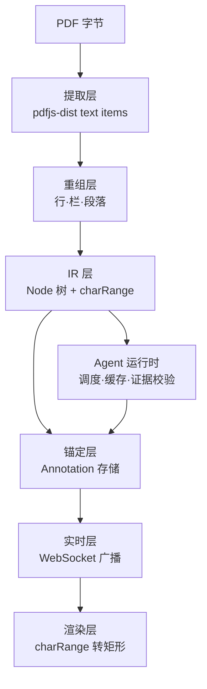

# 论文阅读 Lens 平台：NABCD 与技术方案

2026-09-19 · @Someone

## 项目概述

本项目做的是一套**便于 agent 集成与多人协作的 PDF 论文阅读架构**，不是又一个阅读器产品。

现有阅读器把标注当成人手写的终点，把 AI 当成脱离原文的旁路对话。本架构把标注抽象成可由任意生产者写入的对象：人类是一类生产者，agent 是另一类，二者共用同一套文档表示、同一套锚定机制、同一条实时通道。

这带来的想象空间在于接入成本。任何能产出「原文依据 + 一句结论」的程序，都能成为这个系统里的一个 agent——不需要懂 PDF 解析，不需要处理坐标，不需要关心渲染和同步。写一份十几行的声明即可接入。四个预置 agent 只是第一批使用者，往后可以是审稿清单、复现性检查、统计方法审查、组内的私有评审标准，也可以是实验室自己训练的领域模型。

更进一步，契约本身是模型无关的：底层模型迭代不触碰系统任何一层。而人类对 agent 标注的回复天然构成带原文定位的反馈语料——这是一份多数 AI 阅读产品拿不到的数据，可以直接用于评测集扩充，长期也可用于模型微调。

对读者而言，变化发生在打开论文的头三十秒。今天打开一篇陌生论文，面对的是一片均质的文字：不知道哪里重要、哪里可疑、哪里会卡住，只能从第一页硬啃。在本系统里，文档打开时已经被四个角度扫过一遍——页边的密度条显示哪几节问题最集中，方法段旁标着「这里也可以用 X，作者没用是因为 Y」，实验表格旁标着「这个比较的参数量不对齐」，每一条都能点回它依据的原文。

读的不再是一篇白纸论文，而是一篇已经被人和机器读过、并把痕迹留在上面的论文。组会上讨论过的争议点、上一个师兄卡住的地方、某个 agent 指出的统计问题，都停留在它们发生的那一行上，下一个读者接手时直接可见。新手获得的是原本只有资深读者才有的判断力，课题组获得的是不再蒸发的集体阅读记忆。

## N — 需求

读论文的困难不在单句看不懂，而在读者缺少判断力：判断不出这一步为什么这么做、这个数字算不算好、哪里可能有问题。这些判断需要领域经验，新手没有。

按真实阅读流程逐阶段列出卡点：

| 阶段 | 卡点 | 对应能力 |
| --- | --- | --- |
| 筛选 | 读了三页才发现设定不匹配 | 相关性判断 |
| 入门 | 从头顺读，在 related work 耗时 | 阅读路径建议 |
| 术语 | 第 6 页看到的符号忘了第 3 页的定义 | 定义式检索与跳转 |
| 方法 | 看懂公式但不懂作者为何选这条路 | 替代方案与代价标注 |
| 推导 | 作者写「易得」，中间差三行 | 按需展开中间步骤 |
| 实验 | 表格里 78.3，不知算强算弱 | 基线量级参照与公平性检查 |
| 批判 | 读完只觉得厉害，看不出弱点 | 缺失消融、样本量、成立条件 |
| 串联 | 读了二十篇是二十个孤岛 | 跨论文对比 |

第二类需求来自协作阅读。组会读论文时，讨论发生在会议上、微信里、各自的批注软件里，三者互不相通。下一个读同一篇的人从零开始，前人的困惑和结论都没留下。现有工具要么单机（Zotero 批注不共享或共享很弱），要么只支持网页（Hypothesis 对 PDF 支持有限）。

两类需求指向同一个结构：同一份 PDF 需要承载多套可切换、可共享的标注视图，其中一部分由人写，一部分由机器写。

## A — 方法

核心设计是三条分离。

**标注与文档分离。** PDF 字节永不修改，标注外挂在我们的系统里，通过覆盖层渲染。带来四个性质：文档内容哈希稳定，可直接作为文档 ID 和缓存键；同一份 PDF 可挂任意多套标注并按需开关；实时同步只需传标注，不传文件；多人共享时看到同一份 PDF 与不同的标注视图。代价是标注离开系统即失效，因此需提供导出（扁平化 PDF 或标注 JSON）。

**agent 层与人类层分离。** 二者不是显示上的分组，而是两类数据模型。人类标注可编辑、可回复、可删除，有作者身份，是原始数据。agent 标注一次产出即不可变，要改就重跑并产生新版本，必须携带证据片段与 agent 版本号，是可重算的派生数据。由此得到一条清晰边界：缓存失效、重跑、清理只动 agent 一侧，人类数据永远安全。人类可以回复 agent 的标注，该回复属于人类层，挂在 agent 标注的 ID 上，同时构成评测反馈。

**能力与运行时分离。** 每个 agent 是一份受约束的声明（关注哪类节点、找什么、产出什么），而非一个自由的 prompt 框。运行时负责切片、调度、缓存失效、证据校验和错误隔离。符号定义检索是纯确定性解析、批判点检查是模型调用、跨论文对比是检索加模型——三种实现挂在同一接口下，上层不感知差异。

第三条是这个项目区别于「调 prompt 的产品」的地方：真正被设计的是契约，不是提示词。

## B — 收益

对读者：拿到一篇陌生论文时，不再从零判断。四个预置 agent 分别给出方法审查、实验与统计、可复现性、新颖性四个角度的标注，每条附原文依据，可点击跳转。读者的工作从「自己找问题」变成「核对别人指出的问题」。

对课题组：同一篇论文的讨论沉淀在文档上而不是聊天记录里。下一个读者直接看到前人的标注和争议点。

可量化指标（需在第七周实测，现为待验证的目标值）：

| 指标 | 目标 | 测法 |
| --- | --- | --- |
| 标注定位准确率 | ≥ 90% | golden set 人工标定，比对系统定位的字符区间 |
| 证据校验通过率 | ≥ 95% | agent 产出中 evidenceSpan 可在原文找到且语义相符的比例 |
| 单篇四 agent 耗时 | < 60s | 端到端计时 |
| 首次阅读定位耗时 | 相对基线下降 | 小规模用户实验，读同一篇论文找出指定缺陷的用时 |

最后一项是唯一直接对应用户价值的指标，也最难测准，样本量小，结论只作参考不作结论。

## C — 竞品

| 类别 | 代表 | 能做 | 缺口 |
| --- | --- | --- | --- |
| PDF 阅读器 | Zotero、Adobe、各类 PDF.js 封装 | 手动高亮、批注、跳转 | 标注全靠人写，无自动分析 |
| AI 阅读助手 | 各类「与论文对话」产品 | 问答、摘要 | 答案与原文位置脱节，无法定位到具体段落；无协作 |
| 网页标注工具 | Hypothesis | 共享标注、锚定 | 面向 HTML，PDF 支持弱；无机器标注 |
| 前端标注库 | react-pdf-highlighter 系列 | 高亮渲染、视口无关坐标存储 | 只解决「人选中→存下来」，不解决「系统算出→定位过去」 |

差异点有两条，都需要在答辩时讲清楚。

第一，**方向相反的定位**。现有库全部处理正向映射：用户选中一段，读取 DOM 选区，转换为 PDF 坐标存储。本项目需要反向映射：agent 给出一段文本，系统要找到它在原文中的位置，再算出矩形。这条路径没有现成实现。

第二，**机器标注与人类标注同场**。现有工具二选一：要么全是人写的标注，要么是脱离原文的 AI 对话。把二者放在同一份文档、同一套锚定、同一个实时通道上，是这个项目的形态。

诚实的说明：本项目不在算法上创新，用的是成熟技术的组合。价值在于分层设计与工程实现。

## D — 交付与推广

交付物：可部署的 Web 应用、四个预置 agent、agent 自定义配置界面、评测 harness 与 golden set、设计文档与测试报告、演示视频。

冷启动路径明确：团队四人自己是第一批用户，第七周在本课题组和同学中试用，读真实论文。不需要地推，不需要外部数据源。

推广不作为课程目标。八周内的验证标准是「组会读论文时有人愿意打开它」，而非用户数。

数据所有权：标注存在系统内，提供 JSON 导出与扁平化 PDF 导出两种方式，用户可随时带走。

## 技术架构



各层职责：

- **提取层**：调 `pdfjs-dist` 拿每页的 text item，含字符串、bbox、字体名、字号。纯调库。前后端都用 `pdfjs-dist`，text item 切分一致（栈变更见 02 文档第 12 节）。
- **重组层**：把碎片化的 item 还原成有结构的文本——行聚类、栏识别、段落切分、页眉页脚剔除、跨页续接。输出归一化全文与双向映射表。整个项目技术含量最高的一层。
- **IR 层**：Node 树，每个节点带稳定 ID、类型、charRange。稳定 ID 由结构路径与内容哈希派生。
- **Agent 运行时**：按 agent 声明的 scope 取对应节点，调度执行，校验证据，管理缓存键与失效。
- **锚定层**：标注挂在 charRange 上。正确性要求只有一条：解析器版本升级后，已有标注的 charRange 仍然有效。不做跨文档版本的重锚（见 02 文档第 2 节）。
- **实时层**：服务端为真值源，客户端订阅文档房间，标注增删广播。
- **渲染层**：前端把 charRange 反查成页内几何位置，算出矩形，绘制覆盖层，含降级链。

解析在后端（IR 可缓存、多用户复用），坐标映射必须在前端（依赖当前缩放与视口）。这条边界即「后端给字符区间，前端算像素矩形」，第一周必须定死。

## 核心数据模型

三份契约，第一周定死，之后四人才能并行。契约用 TypeScript 类型定义，前后端共用同一份类型（见 02 文档第 12 节）。

**IR**

```
Document { id, contentHash, pageCount, normalizedText }
Node {
  id            // 结构路径 + 内容哈希派生，稳定
  type          // section | paragraph | equation | figure | table | caption
  parentId, order
  charRange     // 在 normalizedText 中的 [start, end)
  pageHint      // 起始页，用于快速跳转
}
CharMap { charIndex → 第几页 + 页内位置 }
```

CharMap 是重组层的产物，也是反向映射的唯一依据。它写对了上下两层都通，写错了到处是玄学 bug。具体表示形式（直接存 bbox，还是存到提取器输出项的索引）留到动手时定，此处不预设。唯一不能松的硬约束：后端提取器与前端渲染器是两个不同的库，text item 切分方式不一致，CharMap 不能假设前端认得后端的 item 下标。

**Annotation（两类）**

```
HumanAnnotation {
  id, docId, authorId
  anchor        // { charRange, contextPrefix, contextSuffix, nodeId }
  body          // 富文本
  version       // 乐观锁
  createdAt, updatedAt, deletedAt
}

AgentAnnotation {
  id, docId
  agentId, agentVersion, runId
  anchor
  evidenceSpan  // 必填，agent 声称依据的原文区间
  comment, severity, confidence
  createdAt     // 无 updatedAt：不可变
}
```

两类共用 anchor 结构，佅生命周期完全不同。人类标注可改可删，agent 标注只能整批重跑替换。

**Agent 声明**

```
AgentSpec {
  id, name, description, version
  scope         // 消费哪类 Node：method | table | equation | all
  instruction   // 找什么
  outputSchema  // 强制含 evidenceSpan / comment / severity
  maxAnnotations // 防止刷屏
}
```

用户自定义 agent 即填写这份声明，不是开放式 prompt 框。运行时据此切片、调度、校验、缓存，也据此防止某个 agent 到处乱标。

## 三个关键技术难点

### 1. 重组层与反向映射

PDF 里没有段落、没有标题、没有符号作用域，只有带坐标的字形。所有结构都要自己恢复。

1. 行聚类：按 transform 的 y 值聚类，容差取字号的一个比例
2. 栏识别：对 x 坐标做直方图，双峰即双栏；分组后再排序
3. 段落切分：首行缩进、行距突变、上一行右边界明显短于栏宽
4. 页眉页脚：跨页出现在相同 y 区间且内容相似的行，剔除
5. 跨页续接：段末右边界满格且无终止标点，则与下页首段合并

每条都是可单测的纯函数。构造测试 PDF，断言「这一页应切出 4 个段落」。

反向映射是这一层的对偶：给定 charRange，反查出它落在页面上的哪些位置，合并同行矩形，跨行拆成多个矩形。这条路径现有库不提供。

### 2. 证据校验

所有 agent 产出必须附 evidenceSpan。系统校验三件事：该区间在 normalizedText 中存在；区间内容与 comment 所述相符；区间落在 agent 声明的 scope 内。不达标则降级为低置信度或直接丢弃。

这一条把 prompt 工作从玄学变成可回归测试的子系统。配 golden set 与评测 harness，每次改 prompt 跑一遍，得到准确率与幻觉率的变化曲线。这是整个项目最该在答辩时展开讲的部分。

### 3. 重跑与版本管理

agent 版本或 instruction 变更后重跑，同一篇论文产出新一批标注。设计：agent 标注按 `(docHash, agentId, agentVersion, runId)` 分组存储，新版本产生新组，默认只显示最新组。

人类回复挂在具体标注 ID 上，随旧组保留。新组中若对应位置也有标注，提示「此处有历史讨论」。

八周内的降级实现：只保留最新组，旧组归档不显示，完整方案写入 future work。

## 实时协作

结论先行：本项目不需要 CRDT 或 OT，服务端做真值源的 WebSocket 广播即可。论证如下。

CRDT 解决的是多人并发修改同一份可变结构。本系统中：agent 标注不可变、整条原子提交，多个 agent 标在同一段是重叠不是冲突，UI 折叠即可；人类标注是 append-only 的线程，只有增、删、回复，没有对同一对象的并发结构修改。

并发确实存在于人类侧的三个场景：两人同时编辑同一条评论正文、同时删同一条、回复到刚被删的线程。用乐观锁处理即可——每条评论带 version，提交时携带，服务端比对，不匹配则拒绝并返回当前值，前端提示「这条已被他人修改」。

实时层的实现范围因此收敛为：文档房间管理、订阅与广播、断线重连后的增量拉取（按 lastSeq）、在场信号（谁正在看这篇）。一周可完成。

在场信号值得单独做：冲突的最佳解决方式是不发生，让人看到「另一人正在读这一节」比事后合并更有效。

## 分工与排期

范围内：PDF 为主；标注不写入 PDF 文件；agent 层与人类层在数据模型上分离；多人实时共享标注。

范围外：PDF 内容编辑、文献库管理、参考文献导入导出。arXiv HTML 版本作为可选解析源，不作为主路径。

技术栈：React + TypeScript + Vite，pdfjs-dist 渲染；后端 Node.js + TypeScript，便于前后端共享处理逻辑；MariaDB 存标注；前后端均用 pdfjs-dist 提取 PDF。渲染层直接用 react-pdf-highlighter 系列或自写覆盖层，不重复造轮子。选型理由与连带影响见 02 文档第 12 节。

| 角色 | 负责 |
| --- | --- |
| A | 提取层 + 重组层 + CharMap（最难，配最强的人） |
| B | IR + 锚定层 + 标注存储 + 实时广播 |
| C | Agent 运行时 + 四个预置 agent + 证据校验 + 评测 harness |
| D | 前端阅读器 + 反向映射与覆盖层 + 标注交互 + agent 配置界面 |

排期以 02 文档第 10 节为准（证据校验已从 W6 提前到 W4），此处不再重复以免两处走偏。

第一周的产出不是页面，是三份契约文档加一条能跑通的最小链路。这三份定下来，项目就成了一半。

## 风险与降级

| 风险 | 后果 | 降级方案 |
| --- | --- | --- |
| 重组层吃掉过多时间 | 主线跑不通 | 先只支持单栏 PDF，双栏放到 W4；定位精度先到段落级 |
| 标注刷屏，页面变马赛克 | 演示效果崩 | 默认只显示高置信度；按 agent 分组开关；页边密度条；每 agent 限量 |
| 渲染定位算不出矩形 | 标注显示不出来 | 降级链：精确矩形 → 整段块 → 页边标记 → 侧栏列表。W1 先做最后一级 |
| agent 产出质量差 | 用户不信任 | 证据校验拦截；低置信度折叠；人类可标记「这条不对」 |
| 扫描版 PDF 无文本层 | 完全无法处理 | 明确排除，不做 OCR，写入 future work |
