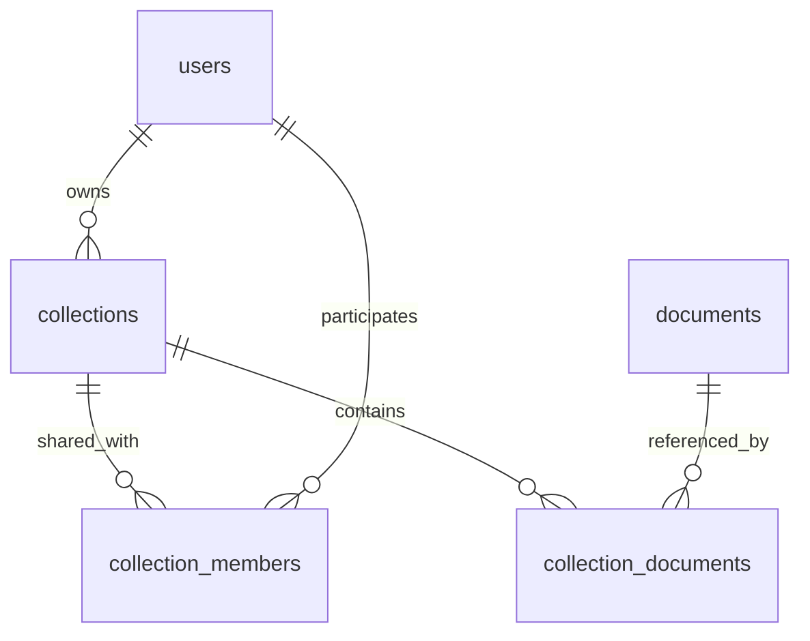

# Collection 数据库设计：个人所有、定向共享

集合功能已实现。建表定义已加入 `apps/server/src/db/schema.sql`；已有数据库可运行 `pnpm db:collections` 幂等创建三张集合表，不会改动已有文献记录。集合列表与详情可从主导航进入，支持搜索、排序、分页、共享以及从 Library/上传/URL 导入添加文献。

## 关系

一个部署实例对应一个组织，沿用现有组织自托管模型，不增加 `organization_id`。

`documents` 是组织文献库，也是 PDF、标题、解析内容及批注所引用的唯一文献记录。`collections` 是个人对这些文献的整理方式。一个用户可以创建多个 collection；同一篇文献可以属于不同用户的多个 collection，也可以暂时不属于任何 collection。owner 可以将集合共享给选定的组织用户，共享用户可查看并增删集合中的文献。共享直接授予已存在的用户，不引入邀请接受流程。

## collections

| 字段 | 类型 | 约束与用途 |
| --- | --- | --- |
| `id` | `CHAR(36)` | 主键，服务端生成 UUID |
| `owner_id` | `CHAR(36)` | 必填，外键指向 `users.id`，从登录用户确定 |
| `name` | `VARCHAR(120)` | 必填，集合名称；保存前去除首尾空白，不能为空 |
| `description` | `VARCHAR(500)` | 必填，默认空字符串 |
| `created_at` | `DATETIME(3)` | 创建时间 |
| `updated_at` | `DATETIME(3)` | 最近修改时间；文献或共享名单实际变更时也在事务内更新 |

- `UNIQUE (owner_id, name)`：同一用户的集合不能重名；不同用户可以使用相同名称。名称比较遵循数据库字符排序规则。
- `INDEX (owner_id, updated_at, id)`：按最近修改时间分页列出“我的 collections”，ID 用于同一时间下的稳定排序。
- `CHECK (CHAR_LENGTH(TRIM(name)) > 0)`：数据库拒绝空名称；长度限制和更完整的空白清理仍由服务端校验。
- 所有者物理删除时，级联删除其 collections；现有其他用户外键若阻止删除用户，仍遵循那些约束。

未共享时仅 owner 可查看和管理。定向共享通过 `collection_members` 表记录，无需 `visibility` 字段；是否存在成员记录就是授权依据。owner 权限直接由 `collections.owner_id` 决定，不重复写入成员表。管理员角色不自动获得查看或修改他人 collection 的产品权限。

## collection_members

| 字段 | 类型 | 约束与用途 |
| --- | --- | --- |
| `collection_id` | `CHAR(36)` | 必填，外键指向 `collections.id` |
| `user_id` | `CHAR(36)` | 必填，外键指向被共享用户 `users.id` |
| `created_at` | `DATETIME(3)` | 本次共享授权时间 |

- `PRIMARY KEY (collection_id, user_id)`：同一用户只授予一次，重复共享为幂等操作，保留原授权时间。
- `INDEX (user_id, created_at, collection_id)`：分页列出“共享给我的 collections”，按收到共享的时间稳定排序。
- 两个外键均使用 `ON DELETE CASCADE`：删除集合或物理删除被共享用户时清理授权。
- 不存 `role`：所有被共享用户都可以查看并增删集合文献，当前无需区分只读用户和编辑者。以后若需要不同共享权限，再增加角色字段。
- owner 不应出现在成员表中；这是服务层需要校验的跨表规则，外键无法单独保证。共享名单管理接口从会话确定 owner，并且只接受当前组织中已存在的用户。
- 撤销共享删除对应成员记录；以后重新授权时生成新的共享时间。撤销不会移除该用户以前添加的文献，因为关联归属于集合。
- 共享用户可以离开集合；服务端只删除当前登录用户自己的成员记录，集合和其中的文献关联均保留。

## 权限边界

| 操作 | owner | 被共享用户 | 其他用户 |
| --- | --- | --- | --- |
| 查看集合与集合文献 | 是 | 是 | 否 |
| 加入组织库文献、移出集合文献 | 是 | 是 | 否 |
| 从集合入口上传或 URL 导入并加入 | 是 | 是 | 否 |
| 修改集合名称、描述 | 是 | 否 | 否 |
| 删除整个集合 | 是 | 否 | 否 |
| 查看和管理完整共享名单 | 是 | 否 | 否 |
| 离开共享集合 | 不适用 | 是（仅撤销自己的访问） | 否 |

共享用户可以移出集合中的任意文献，无论是谁添加的；移出仅删除集合关联，不能据此删除组织 Library 中的文献。集合标题的编辑权限与组织文献标题的编辑权限分开，后者仍沿用现有管理员规则。

## collection_documents

| 字段 | 类型 | 约束与用途 |
| --- | --- | --- |
| `collection_id` | `CHAR(36)` | 必填，外键指向 `collections.id` |
| `doc_id` | `CHAR(36)` | 必填，外键指向组织库 `documents.id` |
| `added_at` | `DATETIME(3)` | 首次加入该集合的时间 |

- `PRIMARY KEY (collection_id, doc_id)`：一个集合中一篇文献只能出现一次，并支持成员存在性检查。
- `INDEX (collection_id, added_at, doc_id)`：按加入时间分页查询集合文献。`added_at` 与文献的组织库导入时间 `documents.created_at` 分开。
- `INDEX (doc_id, collection_id)`：从组织库文献反查其所在集合；查询时限定当前用户可访问的集合。“我的集合”场景仅按所有权筛选。
- 两个外键均使用 `ON DELETE CASCADE`：删除 collection 仅清理关联；组织库物理删除文献时清理其关联。

关联表不重复存 `owner_id`、标题、PDF 路径、全文或批注。写入权限由 collection 的 owner 或共享成员关系决定，文献展示数据通过 `documents` 读取；管理员修改组织文献标题后，各 collection 自然显示新标题。

## 操作与一致性

| 操作 | 数据库行为 |
| --- | --- |
| 创建集合 | 写入 `collections`，所有者使用当前登录用户 |
| 从 Library 加入文献 | 校验 owner 或共享成员权限及文献存在性，插入关联并更新 collection 的 `updated_at` |
| 重复加入 | 幂等成功，保留原有 `added_at`，不重复计数，不更新集合修改时间 |
| 从集合移出文献 | 删除关联并更新 collection 的 `updated_at`；组织库文献、批注和 lens runs 保留 |
| 将文献同时归入多个集合 | 每个目标集合独立写入关联，不复制文献 |
| 删除集合 | 仅 owner 可删除 `collections`，外键清理文献关联和共享成员，组织库文献保留 |
| 修改集合名称、描述 | 仅 owner 可更新 `collections`；重名返回冲突，其他集合不受影响 |
| 共享给选定用户 | 仅 owner 可插入 `collection_members` 并更新集合时间；重复授权不重复写入 |
| 撤销共享 | 仅 owner 可删除指定共享成员并更新集合时间；该成员以后不能访问集合，已有文献关联保留 |
| 从集合入口上传或 URL 导入 | 先导入组织库得到 `doc_id`，再加入目标集合 |

集合名称或描述修改时，数据库的 `ON UPDATE` 负责更新时间；文献关联表和共享成员表的增删不会自动触发父记录更新，后续服务层必须将实际关联变更和父记录更新时间放在同一数据库事务内。重复加入文献、移出已不存在的文献、重复共享和重复撤销都视为无变化。

每次读取和文献增删都需要限定 `collections.owner_id = 当前登录用户 OR EXISTS (该用户的 collection_members 记录)`。修改集合资料、删除整个集合和共享名单管理只允许 `collections.owner_id = 当前登录用户`。外键只保证记录存在，不验证调用者权限；不能仅凭客户端传来的 collection ID、user ID 或 owner ID 授权。

所有修改操作在事务内先锁定目标 `collections` 行，再检查当前有效权限并修改文献关联、共享成员或集合资料，最后更新集合时间。文献增删和撤销授权采用相同的父记录锁顺序，保证撤销共享提交后，后续写操作无法使用先前缓存的授权。集合删除也遵循相同规则。只读查询将授权条件写入同一条 SQL，避免先鉴权、再无条件查询。

共享是集合当前及未来内容的访问权限，不是复制一份快照。owner 或任一成员加入/移出文献后，所有仍有权限的用户看到相同集合内容。撤销后禁止后续访问；已下载的 PDF 或已取得的数据无法收回。实现实时更新时应重新校验授权或及时移出被撤销用户的订阅，不能只在首次加入实时房间时校验。

从集合入口导入的流程：

1. 先校验目标 collection 存在且当前用户是 owner 或共享成员，再执行下载或 PDF 解析。
2. 复用组织库上传/导入流程：按 PDF 字节 `content_hash` 去重，首次导入提取标题，不自动触发 Lens。
3. 得到组织库 `documents.id` 后，再次在事务内锁定 collection 并检查最新授权，幂等加入文献。导入期间可能发生撤销共享。
4. 若导入成功而加入集合失败（例如集合已删除或共享已撤销），保留组织库文献，向用户区分“已导入组织库”和“加入集合失败”，允许重试关联。不能为回滚个人操作而删除共享文献。

加入或共享 collection 不改变文献或批注的可见性：文献仍在组织库中对组织成员可见，批注及个人 lens run 继续遵循现有权限规则。

## 查询与后续接入

- “我的 collections”按 `owner_id` 筛选并分页。集合文献数量使用关联表计数，不存容易失真的冗余计数；列表可针对当前页的 collection IDs 一次分组计数，避免逐集合查询。
- “共享给我的 collections”从 `collection_members.user_id` 查询并分页，连接 `collections` 展示 owner 信息；集合名称只在同一 owner 内唯一，所以共享列表同时显示 owner 昵称。
- 若合并展示“我可访问的 collections”，使用 owner 条件加成员关系 `EXISTS`，避免连接造成重复集合或错误计数。
- 集合内容连接 `collection_documents`、`collections` 和 `documents`。搜索、标题/页数排序复用 Library 的方式，额外支持按 `added_at` 排序；分页和计数使用相同 owner/成员授权与搜索条件。
- Library 文献的“已加入我的哪些集合”可按当前页文献 IDs 批量反查，且始终限定 `collections.owner_id`。
- 当前不引入嵌套集合、手工拖拽顺序、阅读状态、独立文献副本或 collection 内批注空间。这些需求可在明确后扩展，不影响本次三表关系。

实现入口：`packages/contracts/src/collection.ts` 定义共享类型；`apps/server/src/db/collection-repository.ts` 和 `apps/server/src/routes/collections.ts` 实现授权、事务和 API；`apps/web/src/pages/CollectionsPage.tsx` 提供集合界面。集合内上传和 URL 导入先进入组织 Library，再添加集合关联；若加入失败，已成功导入的文献仍保留在 Library。
